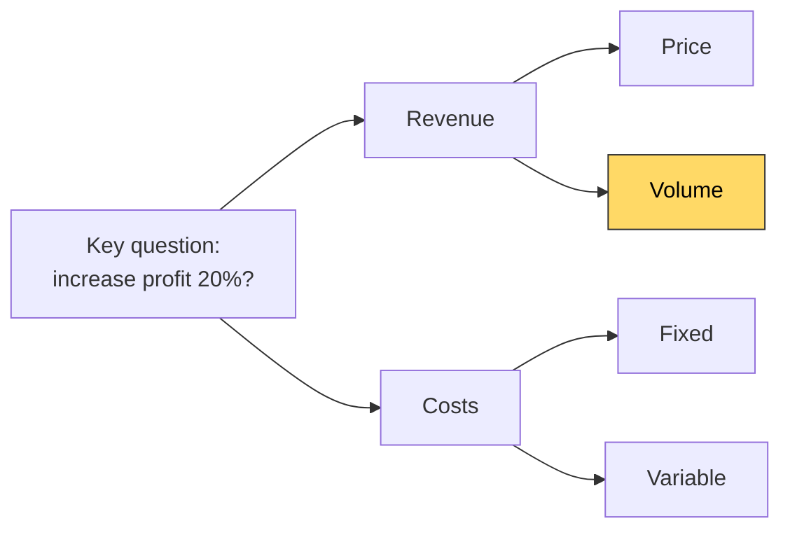
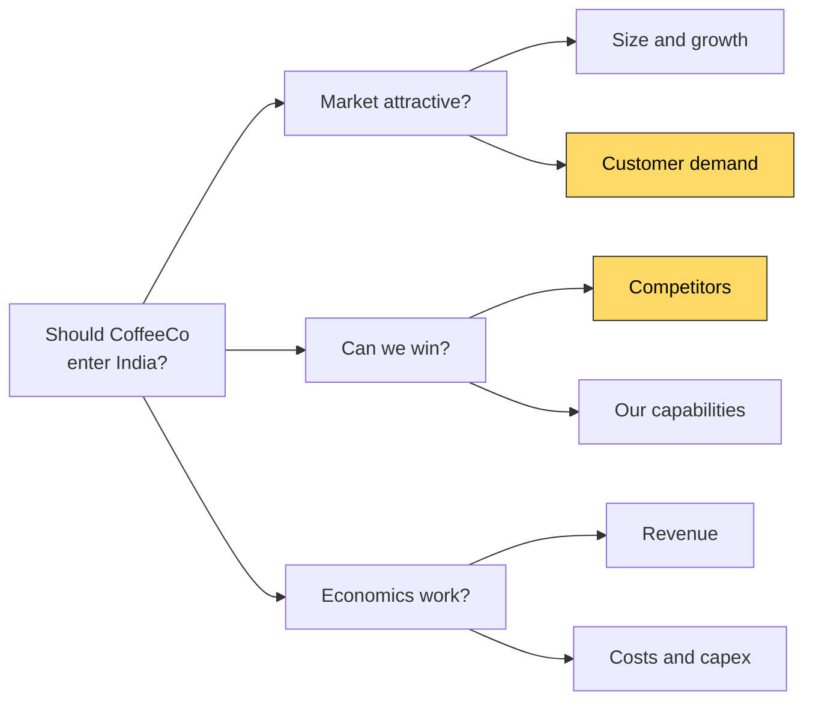

# Preparation Notes
- General cases not just tech related.
- Always asked to create an issue tree!
	- How do I create an issue tree...
	- 1-2 minutes.
	- Talk to interviewer:
		- Main buckets
		- Break down
		- Then final summary and recommendations
- 2 strong stories for each value...
- Always PEI first then case interview
- Check the website for the PEI questions
- Questions for them

# Case Interview
## Steps:
1. Take good notes, writing everything stated
2. Restate the question and the task clearly to the interviewer
3. Ask follow up questions for more detail and explain why you are asking for specific details.

## Tips:
- Don't go into too much detail
- But do ensure we have all the facts right
- Ask for clarification

## Issue Tree

MECE - Mutually Exclusive, Collectively Exhaustive

1. Restate as one measurable key question
2. 3-4 MECE buckets
3. Break each down 2-3 levels
4. Pick the branch to start with, and say why

*(Yellow = where I'd start)*

### Example case: Should a coffee chain enter the Indian market?

*(Yellow = start with demand and competitors: if tea culture dominates and local chains are entrenched, nothing else matters)*

## Interview 1 - Leadership

![[Pasted image 20261029121651.png]]
### Leadership Scenario 1 - Project Manager for Minute Maid
- Lead an 8-person team across countries from Canada to China on a strategy project...

**Headline:** As project manager of an 8-person team spread from Canada to China, I got people with very different backgrounds and working styles aligned by understanding what everyone wanted to get from the project, what their skills were and how they wanted to be managed, and we delivered a proposal for Minute Maid Orange Juice.

##### Context
- Strategy project for Minute Maid, what should the 5-10 year OJ strategy be. Given sales were declining
- 8-person team across several countries, from Canada to China
- We decided that my leadership skills although up until that point had only been in sports, would make me suited to lead
- 4 based in the UK (including myself), 2 in Canada and 2 in China
- 4 week project summer of 2024

##### Challenge
- Team members came from different countries, cultures and working styles
- Communication styles (direct vs indirect), time zones, language, differing expectations of the PM, uneven contribution.
- Why it mattered: risk to the deadline or quality of work.
- I think I made some errors to begin with an kind of assumed that everyone would work in the same way and actually the first week we produced a deliverable that wasn't great and I was looking at it going right.
- Initially I blamed others for the issue and then realised that how could they be performing at their best when I didn't know how to motivate them.

##### My approach
- How I got to understand each person (1:1s, asking how they prefer to work)
- Team set-up: meeting times that were fair across time zones, clear roles, shared channels, written summaries - 1pm UK
- 3 main things I realised:
	- Everyone has a different working style:
		- Some people needed a very specific list of subtasks
		- Some people thrived in a much more hands off approach
	- Everyone has a different communication style 
		- Some people prefered information to be direct
		- Other needed a more gentle set of instructions and didn't appreciate directness
	- Everyone has a very different skill set
		- You have to understand what people are good at, because weirdly enough people often don't put themselves forward for the things they are good at in an environment like that.
- The benefits of diversity

##### Result
- In the end delivered something that was very creative, and produced something I was very proud of. 
- The reason it was so creative was because of the diversity.
- How team dynamics changed and we got on really well and kind of follow each other to this day.

##### Reflection
- Don't assume everyone works like me
- Look at my own approach before blaming others
- Find out how people work early on (was invaluable at tradeweb)
- People don't always nominate themselves for their strengths, that's your job as a leader
- Diversity improved the work

### Leadership Scenario 2 - President of UWMHC
#### Context
- Club was around 110 members
- Was voted for by my peers - had to convince 110 people I was the right person for the job
- Just talk about 1 situation during my time as president
#### Candidate scenarios
- Performance based pay for coaches
- Implemented KPIs 
- Disciplinary action
- Conflict mediation with the SU
- All teams getting demoted
- Lost our performance funding
#### Background
- Give a speech to 100+ people on why I was the right person for the job
- Went in knowing that we had to change the way we did things
- The year before our 1st team had been relegated
- Our performance funding was withdrawn and yet we wanted to be ambitious as a club
No problem, here it is with `####` for the main heading and `#####` for the sections.

#### Leadership: UWMHC 1st Team Captain

**Headline:** As president, I learned that the 1st team captain needed a more hands-on style of leadership than I was giving him, and changing my approach helped get the team back on track.

##### Context
- The year before I took over, the 1st team had been relegated and the club's performance funding was withdrawn
- Despite this, we wanted to be ambitious and get back up; the challenge was doing more with less (e.g. I structured a performance-based bonus to bring in the coach we wanted)
- I was elected president with a clear sense that we had to change how the club was run
- I was balancing this with part-time work and my studies

##### Challenge
- The 1st team captain was central to getting promoted, but he had become despondent after the relegation
- Discipline in the team was slipping: he was turning up late and equipment was being lost
- Then there was the knock on effect to others in the team and their attitudes. 
- It was also being reflected in results in a league where they should've dominated

##### My mistake
- I definitely made some mistakes here
- I was very hands-off and left him to get on with it
- I assumed the expectations of the role were implicit and that he knew what was required
- I respected his autonomy but maybe didn't realise that people needed different leadership styles.
- Had this realisation that very different diverse people needed different management styles.
- And initially I thought it was on him and considered replacing him.

##### Turning point
- I realised that people need different leadership styles: some respond well to space, others need more guidance and a nudge.
- He was one of the latter, and my approach wasn't working for him.
- We debated replacing him but on paper he was one of the best players and also a very bright guy.

##### Actions
- I sat down with him and made the expectations of the role explicit
- [TO FILL] Where and when the conversation happened, what I said, how I framed it (supportive vs firm)
- [TO FILL] How he reacted: defensive, relieved, pushback?
- [TO FILL] What I did afterwards to support him: check-ins, giving him ownership of something, involving the vice-captain or coach

##### Result
- [TO FILL] How his behaviour and the team's discipline changed
- [TO FILL] The season's outcome: league position, promotion, funding returned, attendance (numbers where possible)

##### Reflection
- Getting the best out of people is one of the most interesting problems to solve, and there is no single leadership style that works for everyone
- My biggest mistake was assuming expectations were implicit; I now set them out explicitly from the start
- [TO FILL] What I'd do differently, and how I've applied this since (e.g. at Tradeweb)

##### Context
- I think getting the best out of people is one of the most interesting problems to solve
- I very quickly learned that everyone needs a different leadership style
- Some people you can be hands off, some people you need to give a lot more guidance and you have to figure out what they need.
- Basically I could see the 1st team captain had become really unmotivated.
- He had become really despondent that the the team had been relegated and I was kind of just leaving him to do his thing, but the team lacked discipline and he was turning up late to stuff, losing equipment.
- I was super hands off, letting him get on with it.
- I came to the realisation that he was one of those people that needs a bit more of a nudge sometimes. 
- I made it clear to him what the expectations were, the biggest mistake I think I made with this was that I assumed the expectations were implicit. 

#### Performance Based Pay
- So the biggest problem we had was do more with less
- There was this 1st team coach we really wanted to sign, but he wanted more money.
- So we basically came up with the idea to give him performance based pay.
- Which meant that if the 1st team got promoted, he would get a bonus with the money we would get from the SU as we would get our performance funding back.
### Leadership Scenario 3 - 2nd XI Captain of UWMHC
- Team was down 3-0 
- Turned it around
## Leadership Scenario 4 - Tradeweb AI Research Assistant

## Interview 2 - Drive

![[Pasted image 20261029121600.png]]

### Drive Scenario 1 - Dealing with a chronic autoimmune disease while getting 78% in my first year.
**Headline:** Achieved a high first in my first year despite being diagnosed with an autoimmune disease.

##### Context
- For context during my 1st year at uni I was:
	- Working as a maths tutor to help pay my way through
	- Training and playing 6 times a week with the performance hockey squad at Warwick
	- First time away from home learning to look after myself 
	- Making new friends and managing my relationships
	- Doing job applications
	- And all of this while being diagnosed with an autoimmune disease that gave me chronic fatigue and brain fog. 
	- Still needing to perform at my best whether that was in hockey or being there for my friends and family. 

##### Challenge
- I knew I wanted to get a 1st in my degree and excel and perform in a subject that I loved
- I knew I wanted to run the hockey club and take it in the right direction
- I knew I wasn't going to let it stop me from performing at my best.
- I just realised I had to be organised within an inch of my life.
##### Actions
- Planning things to the minute being ultimately disciplined with my time.
- Weekly schedule, fixed study blocks.
- And as sad as it was at the time the only way I could keep up with my commitments when was I going to get lunch, when was I going to go to my doctors appointments have my blood tests.
- Had to say no to a lot of socials.
- And had to learn when to ask for help

##### Result
- I then went on, continuing to fight to do what I needed to do to get healthy and even after I left uni going on to become captain of the second team and then president of the club.
- Achieved 78% in my first year, got a first overall. Consistently ranked in the top decile for my exams
- Securing a job at a fintech firm.
- It gave me the habits I needed to be able to run these things effectively.

##### Reflection
- Didn't really get fully healthy until a year ago but the resilience and grit I had to show to get to where I am today and achieve what I needed to achieve I will never lose.

### Drive Scenario 2 - Estonia Walk

## My questions for McKinsey
What are the skills you feel like you've gained at McKinsey that maybe you couldn't have learnt anywhere else?
